# Rediseño de Decodifica

Octubre de 2026. **Jordi eligió la propuesta A («Revista luminosa») y ya está aplicada a toda la web** (ver «Fase 2: resultado» al final). Primero se hicieron tres propuestas para la página principal, la lista del blog y la página de artículo, pensadas para lucir las portadas nuevas (pull request #13, `docs/portadas.md`), como maquetas con los artículos, portadas y datos de Search Console reales.

## Qué falla hoy (móvil)

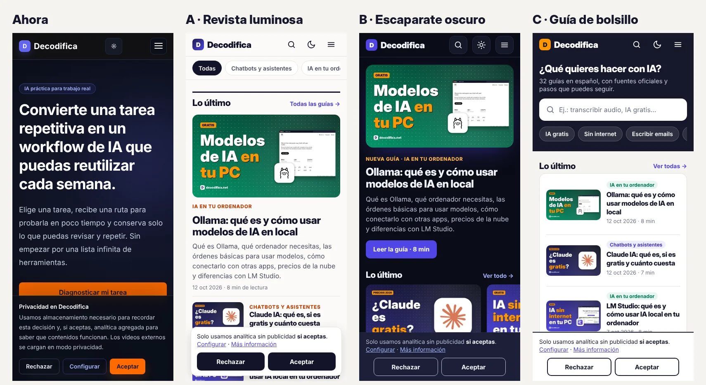

- Arriba sale un texto abstracto («Convierte una tarea repetitiva en un workflow de IA…») y un botón: ningún artículo ni ninguna portada en la primera pantalla. El primer enlace a un artículo aparece a 4.340 px de altura (unas cinco pantallas más abajo) y la portada no tiene ni una imagen.
- Muchas cajas oscuras iguales con letra pequeña: parece una aplicación, no una revista.
- El aviso de cookies mide 207 px de alto: una cuarta parte de la pantalla, justo encima del botón principal.
- En el artículo, la portada queda tapada por el aviso, y el «En resumen» se pierde como un párrafo más.

## Las tres propuestas

Las tres comparten lo importante: **un artículo con su portada en la primera pantalla**, temas para navegar, «Lo más leído» (con los datos de Search Console), buscador, y en el artículo un recuadro de **respuesta rápida**, índice, tablas que se deslizan, cajas de consejo y «ojo», boletín a mitad del texto sin ventanas que molesten y artículos relacionados con portada. Y un **aviso de cookies pequeño** con «Rechazar» y «Aceptar» del mismo tamaño y estilo.

| | A · Revista luminosa | B · Escaparate oscuro | C · Guía de bolsillo |
|---|---|---|---|
| Fondo | Claro (con modo oscuro opcional) | Oscuro, como ahora | Claro, color papel |
| Primera pantalla del móvil | El último artículo con su portada grande | El último artículo con su portada grande y un botón «Leer la guía» | Un buscador «¿Qué quieres hacer con IA?» y atajos por tarea |
| Lista de artículos | Tarjetas grandes con portada | Filas que se deslizan con el dedo (como Netflix o YouTube) | Lista compacta: portada pequeña a la izquierda y título |
| Lectura | Letra sin serifa, 18 px, 700 px de ancho máximo, índice a la izquierda en ordenador | Letra clara sobre fondo oscuro, 18 px, índice que se queda fijo arriba al bajar | Letra con serifa (tipo libro), 19 px, índice y boletín a la derecha en ordenador |
| Parecido a | Xataka, The Verge, revistas | Plataformas de vídeo | Zapier, How-To Geek, manuales |

### A · Revista luminosa (recomendada)

| Inicio | Blog | Artículo |
|---|---|---|
| 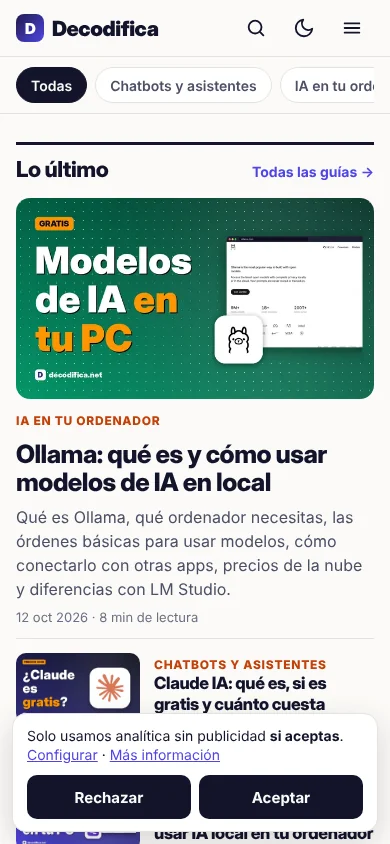 | 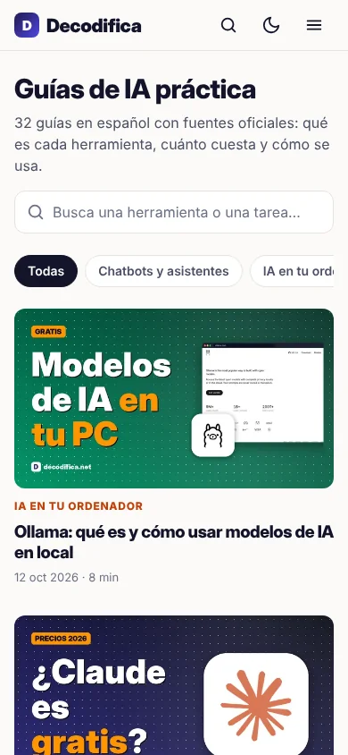 | 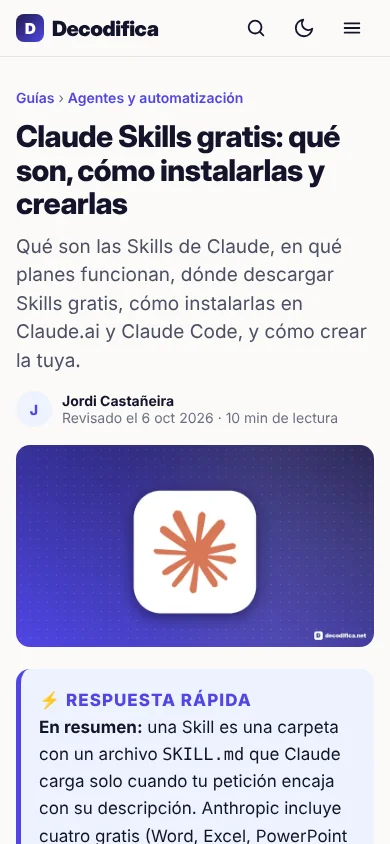 |

Ordenador: [inicio](propuesta-a/inicio-ordenador.jpg) · [blog](propuesta-a/blog-ordenador.jpg) · [artículo](propuesta-a/articulo-ordenador.jpg) · [artículo en modo oscuro](propuesta-a/articulo-oscuro-ordenador.jpg). Móvil completo: [inicio](propuesta-a/inicio-movil.jpg) · [blog](propuesta-a/blog-movil.jpg) · [artículo](propuesta-a/articulo-movil.jpg) · [artículo en modo oscuro](propuesta-a/articulo-oscuro-movil.jpg).

### B · Escaparate oscuro

| Inicio | Blog | Artículo |
|---|---|---|
| 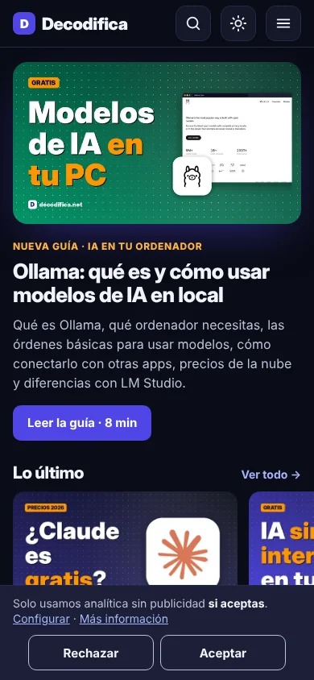 | 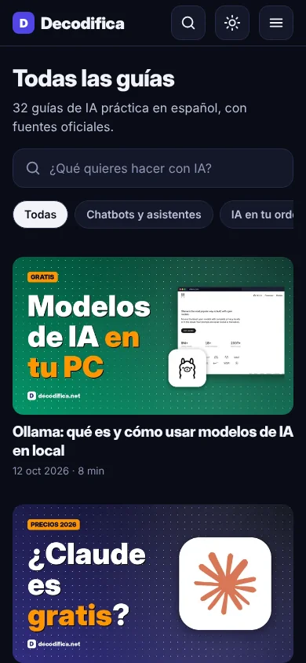 | 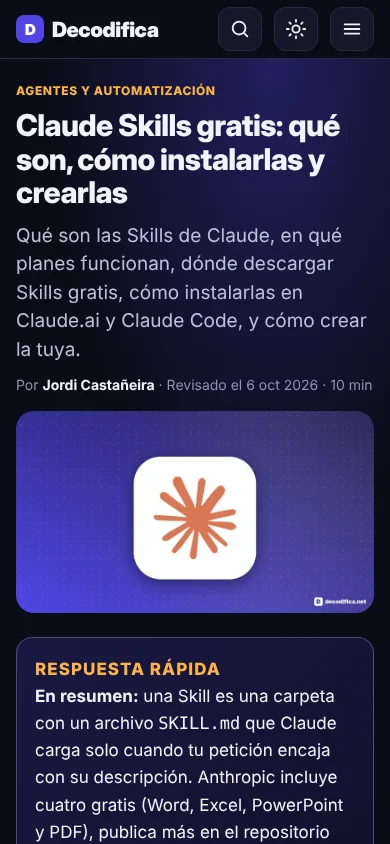 |

Ordenador: [inicio](propuesta-b/inicio-ordenador.jpg) · [blog](propuesta-b/blog-ordenador.jpg) · [artículo](propuesta-b/articulo-ordenador.jpg). Móvil completo: [inicio](propuesta-b/inicio-movil.jpg) · [blog](propuesta-b/blog-movil.jpg) · [artículo](propuesta-b/articulo-movil.jpg).

### C · Guía de bolsillo

| Inicio | Blog | Artículo |
|---|---|---|
| 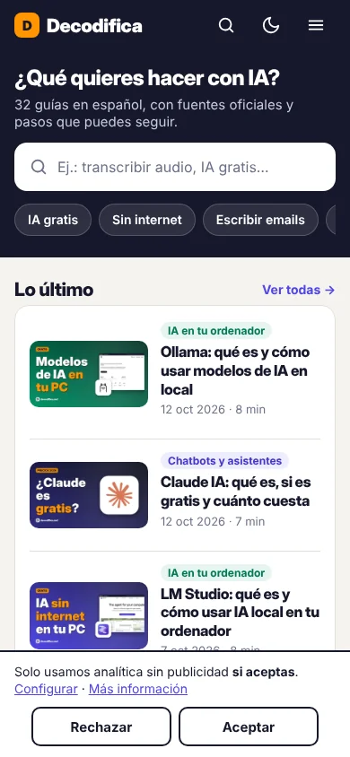 | 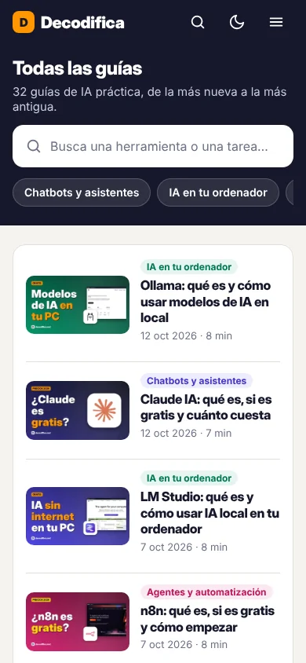 | 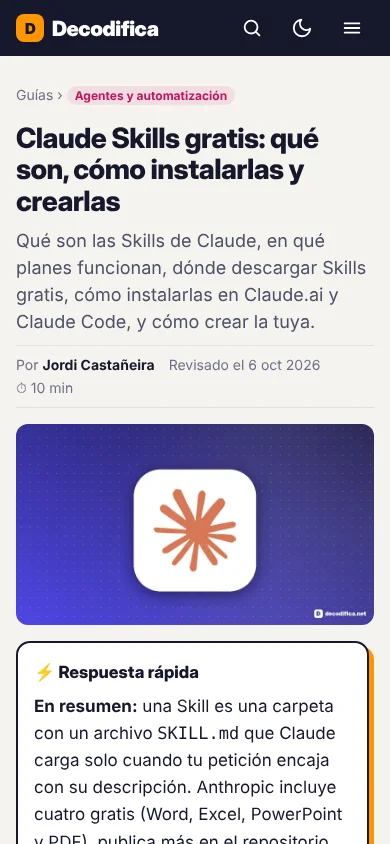 |

Ordenador: [inicio](propuesta-c/inicio-ordenador.jpg) · [blog](propuesta-c/blog-ordenador.jpg) · [artículo](propuesta-c/articulo-ordenador.jpg). Móvil completo: [inicio](propuesta-c/inicio-movil.jpg) · [blog](propuesta-c/blog-movil.jpg) · [artículo](propuesta-c/articulo-movil.jpg).

Hoy: [inicio](antes/inicio-movil.jpg) · [blog](antes/blog-movil.jpg) · [artículo](antes/articulo-movil.jpg) (móvil, página completa).

Comparativas de la primera pantalla en el móvil: [inicio](comparativa-inicio-movil.webp) · [blog](comparativa-blog-movil.webp) · [artículo](comparativa-articulo-movil.webp).

## Por qué recomendamos la A

- **Las portadas se ven más.** Son de colores fuertes; sobre fondo claro destacan, sobre fondo oscuro compiten con él.
- **Se lee mejor un texto largo.** Para artículos de 8-10 minutos, el texto oscuro sobre fondo claro cansa menos a la mayoría de la gente, y quien prefiera oscuro tiene el modo oscuro.
- **Parece una revista**, que es lo que se echaba en falta: es el formato de los medios de tecnología con más visitas.
- **Es la más fácil de mantener**: tarjetas y listas sencillas que los agentes de cada semana no pueden romper.

La B también arregla los problemas principales (artículo y portada arriba, aviso de cookies pequeño) y se parece más a la web de hoy. Su punto débil: las filas que se deslizan esconden artículos a la derecha y mucha gente no las desliza.

## Lo que se ha aprendido de otras webs

Investigación completa, con medidas y fuentes: [`investigacion.md`](investigacion.md). Se miraron 12 webs en el móvil (Xataka, Genbeta, Computer Hoy, Wwwhat's new, The Verge, Ars Technica, Zapier, The Rundown AI, Smashing Magazine, Android Authority, How-To Geek y Tom's Guide). Solo se sacaron patrones, sin copiar diseños:

- **Primera pantalla:** el logo, una línea que diga qué es la web y enseguida la guía destacada con su portada 16:9. El título va debajo de la portada, no encima, porque la portada ya lleva su gancho.
- **Temas en chips** que se deslizan de lado bajo la cabecera, y **dos tamaños de tarjeta**: grande para la destacada y filas compactas (miniatura de unos 120 px) para el resto.
- **Lo más leído numerado**, de 3 a 5 títulos sin imagen.
- **Lectura:** casi todas usan letra de 18 px en el móvil (entre 17 y 19), con interlineado de 1,5 a 1,6, y unos 66-70 caracteres por línea en el ordenador (de 640 a 700 px). Las que pasan de 85 caracteres cansan.
- **Artículo:** tema, título, entradilla, fechas y la portada; un resumen al principio, un índice plegable solo en guías largas, cajas de consejo con borde de color y tablas que se deslizan.
- **Boletín:** al final del artículo (entre el 86 y el 94 % de la página), nunca en ventanas emergentes ni fijo en la pantalla.
- **Cookies:** una barra pequeña con «Rechazar» y «Aceptar» del mismo tamaño y aspecto, más «Configurar». La guía de la AEPD (mayo de 2024, apartado 3.2.3) pide que rechazar se ofrezca «al mismo tiempo, al mismo nivel y con la misma visibilidad» que aceptar. Lo que hay que evitar son los muros de «paga o acepta».

## Qué se planteó para la fase 2

- Mismas direcciones de todas las páginas; títulos, descripciones, datos estructurados, `llms.txt`, robots, sitemap y enlaces internos sin tocar.
- Componentes nuevos para los artículos: `RespuestaRapida` (el recuadro, que mantiene el párrafo «**En resumen:**» que piden las reglas para las IA), `Indice`, `Caja` (consejo / ojo / nota), `Tabla` (se desliza en el móvil) y `BoletinEnTexto`. Se aplican a los 32 artículos y se explican en `docs/AGENTE-SEMANAL.md`.
- Temas: un campo `tema` en cada artículo (5 temas: Chatbots y asistentes, IA en tu ordenador, Agentes y automatización, Trabajo y día a día, Imagen, vídeo y webs). Se filtran en `/blog/` sin crear páginas nuevas.
- «Lo más leído» se calcula solo en cada build con el último informe de Search Console (`data/gsc_weekly/latest.json`).
- Buscador: un índice pequeño (título, descripción y temas de cada guía) que se busca en el propio navegador; sin servicios externos.
- Velocidad: la letra de los titulares (Inter Display, la de las portadas) se sirve desde la propia web y solo en el peso que se usa; el texto, con la letra del sistema. La portada del primer artículo se carga la primera; el resto, al bajar.
- Aviso de cookies: se mantiene el mismo funcionamiento (Plausible solo si se acepta, «Configurar» para elegir), solo cambia el aspecto y el tamaño.
- Accesibilidad: contraste AA en textos, botones y zonas de toque de 44 px o más, foco visible, modo claro/oscuro.

## Cómo se hicieron las maquetas y capturas

```bash
python3 docs/rediseno/maquetas/generar.py                 # crea docs/rediseno/maquetas/{a,b,c}/*.html
python3 -m http.server 8765 &                              # desde la raíz del repositorio
python3 scripts/capturas_rediseno.py http://localhost:8765 docs/rediseno/propuesta-a \
    inicio=/docs/rediseno/maquetas/a/inicio.html blog=/docs/rediseno/maquetas/a/blog.html articulo=/docs/rediseno/maquetas/a/articulo.html
```

`capturas_rediseno.py` sirve también para la web de verdad (`npm run build && npx astro preview` y `http://localhost:4321`): guarda la primera pantalla (`-pantalla.webp`) y la página entera (`.jpg`) a 390 px y 1280 px.

El texto del artículo de ejemplo es un resumen del artículo real de Claude Skills; los temas de cada artículo son una propuesta.

## Fase 2: resultado (propuesta A aplicada)

| Inicio | Blog | Artículo | Artículo en modo oscuro |
|---|---|---|---|
| 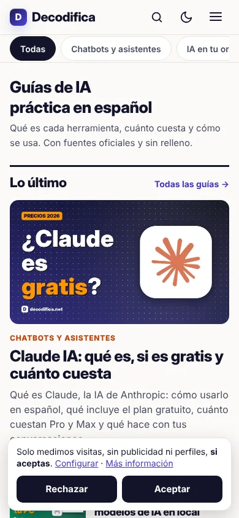 | 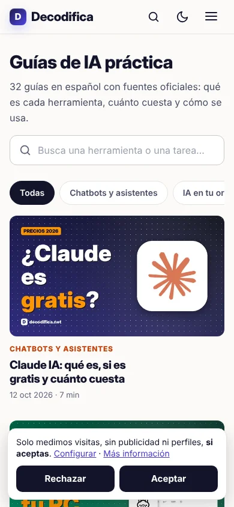 | 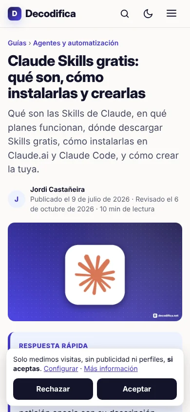 | 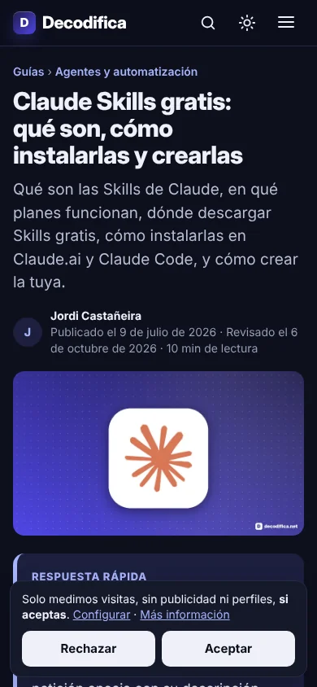 |

Ordenador: [inicio](final/inicio-ordenador.jpg) · [blog](final/blog-ordenador.jpg) · [artículo](final/articulo-ordenador.jpg) · [artículo con tablas](final/articulo-tabla-ordenador.jpg). Móvil completo: [inicio](final/inicio-movil.jpg) · [blog](final/blog-movil.jpg) · [artículo](final/articulo-movil.jpg) · [artículo con tablas](final/articulo-tabla-movil.jpg).

**Qué cambia**
- Fondo claro por defecto. El modo oscuro está en el botón de la luna y se recuerda en cada visita. Los titulares usan Inter Display, la letra de las portadas (20 KB, alojada en la propia web).
- **Portada:** la última guía con su portada en la primera pantalla, otras 4 en filas, «Más guías», «Lo más leído» (con los datos de Search Console), los temas en colores, el boletín y las herramientas gratis.
- **Blog:** buscador, filtro por temas (`/blog/?tema=local`) y tarjetas con portada; se ven 12 guías y un botón para ver el resto. Sin JavaScript se ven todas.
- **Artículo** (plantilla `src/components/Articulo.astro`): tema, título, entradilla, fechas y portada. El «En resumen» sale en el recuadro **Respuesta rápida** (los 5 resúmenes en lista y los 9 recuadros antiguos tipo «En dos líneas» también). Hay **índice** cuando la guía tiene 5 apartados o más (en el móvil se pliega; en el ordenador va fijo a la izquierda), tablas que se deslizan, cajas `Caja` (consejo, ojo y nota) y una línea de **boletín antes de las fuentes**. Al final: recursos, autor y 3 artículos relacionados del mismo tema con portada. Desaparecen el boletín duplicado y los enlaces «anterior/siguiente».
- **Temas:** cada artículo tiene `const tema` (5 temas en `src/lib/temas.ts`).
- **Cookies:** la barra pasa de 207 a 119 px de alto en el móvil. «Rechazar» y «Aceptar» son iguales (164x44 px) y «Configurar» está en la primera capa. En el pie hay un botón nuevo, «Cambiar cookies», para retirar el consentimiento. Plausible se sigue cargando solo si aceptas, como antes.

**Comprobaciones (14-10-2026)**
- `npm run build` (121 páginas) y `npm run type-check`: sin errores.
- SEO: se compararon las 121 páginas construidas con las de `main`. Los títulos, descripciones, canónicas, `og:*`/`twitter:*` y datos estructurados (JSON-LD) son idénticos en todas, igual que `llms.txt`, `robots.txt` y el sitemap. El RSS solo cambia en la fecha de construcción. Solo cambian los H1 de la portada («Guías de IA práctica en español») y del blog («Guías de IA práctica»). Ninguna dirección cambia.
- `python3 scripts/seo_preflight.py src/pages/blog/*.astro`: 0 errores. Quedan los mismos avisos que en `main` (sobre todo «imágenes dentro del texto» y 4 artículos sin «En resumen»: `2026-07-17-hermes-agent-chino`, `2026-07-22-nano-banana-1000-prompts`, `5-atajos-ia-gratis` y `gpt-live-voz-chatgpt`, que necesitan un resumen escrito con fuentes).
- `python3 scripts/web_health_check.py --skip-build --skip-production`: mismo resultado que en `main` (`ok: false` en los dos solo porque echa de menos TikTok y YouTube, que se quitaron a propósito).
- Accesibilidad (axe-core 4.10, WCAG 2 A/AA, 110 páginas a 390 px): **0 problemas en modo claro y 0 en oscuro** (en `main` había 39 en 21 páginas).
- Velocidad en el móvil (conexión lenta simulada de 1,6 Mbit/s con 150 ms de latencia y procesador 4 veces más lento, mediana de 3 cargas). LCP de `main` → diseño nuevo: inicio 516 → 600 ms, blog 536 → 604 ms, artículo de Claude Skills 672 → 728 ms, artículo de Ollama 628 → 672 ms. CLS 0 en todo. La portada y el blog suben algo porque ahora enseñan imágenes (antes la portada no tenía ninguna), pero todo queda muy por debajo de los 2,5 s que Google considera «bueno».
